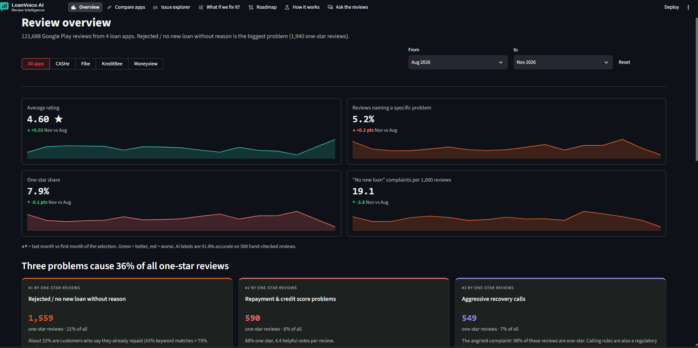
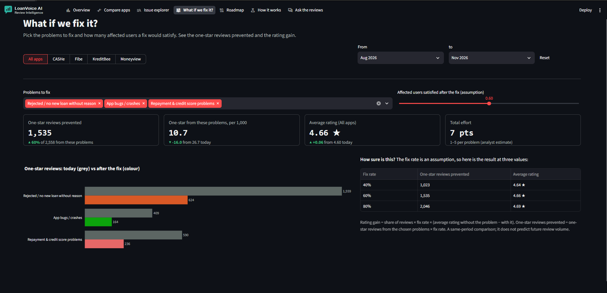
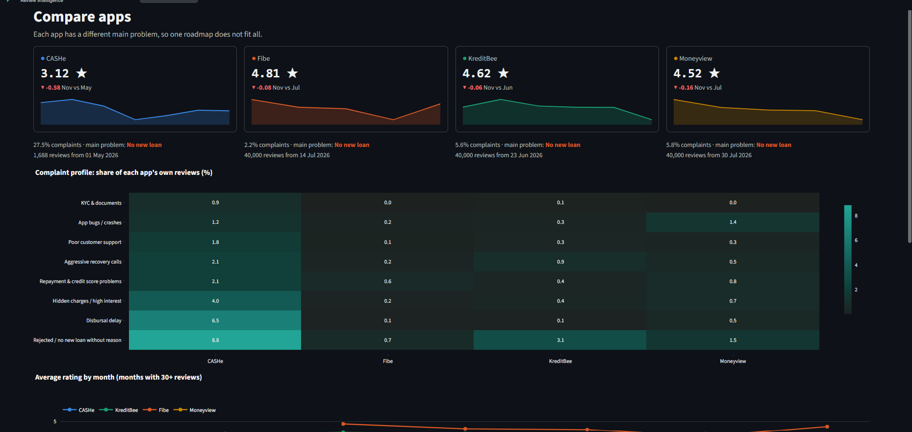
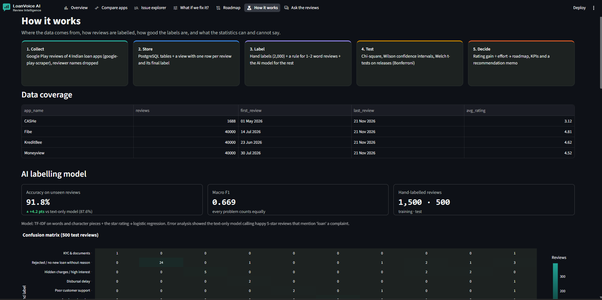

# LoanVoice AI: what loan-app users complain about, and what to fix first

I analysed **121,688 real Google Play reviews** of four Indian loan apps (KreditBee, Moneyview, Fibe, CASHe)
with **Python, PostgreSQL, an AI classifier and statistics**, and turned the findings into a
**prioritised 3-month product roadmap** and an **interactive Streamlit app**.

**Live app:** _coming soon_ · **2-minute video:** _coming soon_ · **Business analysis:** [docs/business_analysis.md](docs/business_analysis.md)



---

## The problem

Loan apps show high ratings (4.5–4.8★, except CASHe at 3.1★), but the average hides a concentrated set of
problems. Product teams cannot read thousands of reviews a month, so they don't know **which problem hurts
most, whether a release made things worse, or what to fix first**. LoanVoice AI answers those three questions.

## Key findings

1. **Problems hide in a small share.** 91% of reviews are positive. Only 5,874 (4.8%) name a specific problem,
   yet they cause **53% of all 8,979 one-star reviews**.
2. **#1 problem: "Rejected / no new loan without reason".** 2,280 reviews, 85% one-star, **1,940 one-star reviews
   (22%, about 1 in 5)**, almost 3× the next problem.
3. **Many of them are good customers.** About **1 in 3** (~730) say they had **already repaid** a loan and were then
   refused (keyword match, 15 of 20 confirmed by a manual check). KreditBee is the worst (48% of its cases).
4. **Recovery calls are the angriest** (97% one-star) and a regulatory risk under RBI recovery rules.
   **Repayment problems are what other users agree with most** (4.2 "helpful" votes per review; payments not
   updated, late fees despite paying).
5. **Watch review volume, not just the rating.** CASHe's rating fell **3.72 → 2.49★** after version 9.2.6
   (Welch t-test p < 0.001, Cohen's d = −0.67). But complaints did **not** rise (65 → 65); **happy reviews fell 72%**
   (231 → 64). A control app (KreditBee) stayed steady in the same weeks.
6. **Each app needs its own fix:** CASHe → disbursal speed and hidden charges; KreditBee → "no new loan";
   Moneyview → app stability; Fibe → cleanest overall.

Full details, numbers and caveats: [docs/findings.md](docs/findings.md)

## What I recommend

| Month | Fix | Why |
|---|---|---|
| 1 | Show the decline reason + reapply date; warn before foreclosure | #1 priority: biggest rating gain for one screen (effort 2) |
| 1 | Written recovery-calling rules (8:00–19:00, max 3 calls/day, no calls to contacts) | Compliance risk, so it jumps the queue |
| 2 | "Pay now" before auto-debit; no late fee when our systems fail | Most-agreed complaint |
| 3 | Support ticket tracking, disbursal tracker, re-run this analysis | Measure results against the KPIs |

**Goal:** cut one-star reviews from the top 3 problems by **40% in 3 months** (2.7% → 1.6% of reviews), with
guardrails so default rates and recoveries don't get worse. Problem statement, stakeholders, 5 Whys,
user stories, KPIs and a one-page memo: [docs/business_analysis.md](docs/business_analysis.md)

## How it works

```
Google Play reviews ─► PostgreSQL ─► AI labelling ─► SQL + statistics ─► Rating-gain model ─► Roadmap
 (google-play-scraper)  (tables + view)  (TF-IDF + stars    (chi-square, Wilson CI,   (gain ÷ effort)   + memo
                                          → logistic reg.)   Welch t-test, Cohen's d)
                                                  │
                                    Streamlit app (7 pages)  ·  Power BI / Tableau read the same view
```

## The AI model

- Labels every review as one of 8 problems, positive or other.
- **91.8% accuracy** on 500 unseen test reviews (baseline, always guessing "positive": 78.8%); **macro F1 0.669**.
- **Error analysis → improvement:** the text-only model (87.6%) called happy 5-star reviews that mention "loan"
  complaints. Adding the star rating as a feature lifted accuracy to 91.8% and "no new loan" precision from 62% to 77%.
- Labels: 2,000 reviews labelled with AI assistance; I reviewed the 47 most uncertain test labels myself.

## Checking my own work

Good analysis means questioning your own results. Things I caught and fixed:

- **Rate vs count:** CASHe's complaint *share* doubled after 9.2.6, but the *count* didn't change; happy reviews disappeared.
- **Uneven data coverage:** big apps hit the 40,000-review download cap, so their data starts later. I found it with a
  control check and fixed the release test to use each app's own start date.
- **Mislabelled and copied reviews:** the most-voted "repayment" review was about a different app, and 140 reviews
  (0.1%) are copies. I measured, reported and corrected rather than deleting silently.
- **Over-counting:** the model inflated "no new loan" (2,732 → 2,280 after the fix).
- **Circular statistics:** issue-vs-rating tests partly reuse the stars, so I confirmed the severity order with the
  earlier text-only model.

## The app

Seven pages: **Overview · Compare apps · Issue explorer · What if we fix it? · Roadmap · How it works · Ask the reviews**

| What if we fix it? (simulator) | Compare apps |
|---|---|
|  |  |



## Tech stack

| Area | Tools |
|---|---|
| Data collection | Python, google-play-scraper |
| Storage & SQL | PostgreSQL 16, SQLAlchemy, pgAdmin (CTEs, window functions, FILTER, ROLLUP, regex) |
| AI / ML | scikit-learn (TF-IDF + logistic regression), error analysis, confusion matrix |
| Statistics | SciPy: chi-square, Cramér's V, Wilson CI, Welch t-test, Bonferroni, Cohen's d |
| App | Streamlit, Plotly; optional LLM (Ollama or any OpenAI-compatible API) for "Ask the reviews" |
| Business analysis | Problem statement, stakeholder map, 5 Whys, user stories, KPIs, roadmap, memo |

## Project structure

```
app/streamlit_app.py        the 7-page app
loanvoice/                  pipeline code: database, classifier, statistics, rating-gain model, assistant
pipeline.py                 runs everything: load -> label -> statistics -> roadmap
collect_more.py             downloads the reviews
make_label_sheet.py         picks reviews for hand labelling
sql/analysis_queries.sql    all SQL analysis queries (run in pgAdmin)
docs/                       findings, business analysis, data sources, decisions, interview prep
```

## Run it yourself

```
python -m venv .venv
.venv\Scripts\activate
pip install -r requirements.txt
$env:DATABASE_URL="postgresql+psycopg2://postgres:<password>@localhost:5432/loanvoice"
python collect_more.py              # 1. download reviews into data/ (review data is not stored in this repo)
python make_label_sheet.py          # 2. pick reviews to label -> save the labels as data/hand_labels.csv
python pipeline.py run              # 3. load, label, test, build the roadmap
streamlit run app/streamlit_app.py  # 4. open the app
```

## Limitations

- Reviews come from a vocal minority: they show what hurts, not how many customers are affected.
- Apps cover different date ranges (download cap); cross-app month comparisons use August 2026 onwards.
- Root causes beyond what reviews say are hypotheses to confirm with the product, risk and collections teams.
- Public reviews only; reviewer names are dropped and no personal data is stored.

---

**Author:** Sharan · CSE graduate · aspiring Data / Business Analyst · [LinkedIn](https://www.linkedin.com/in/your-profile)
